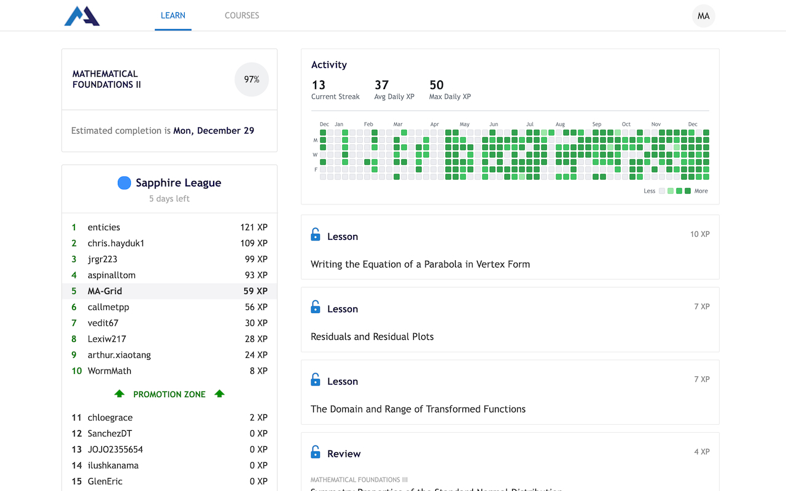
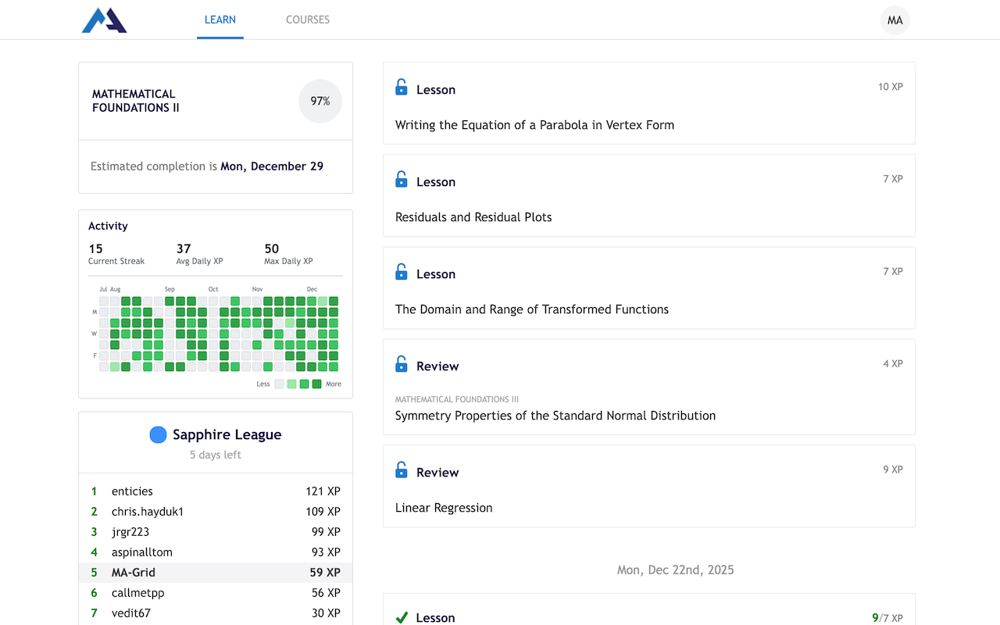
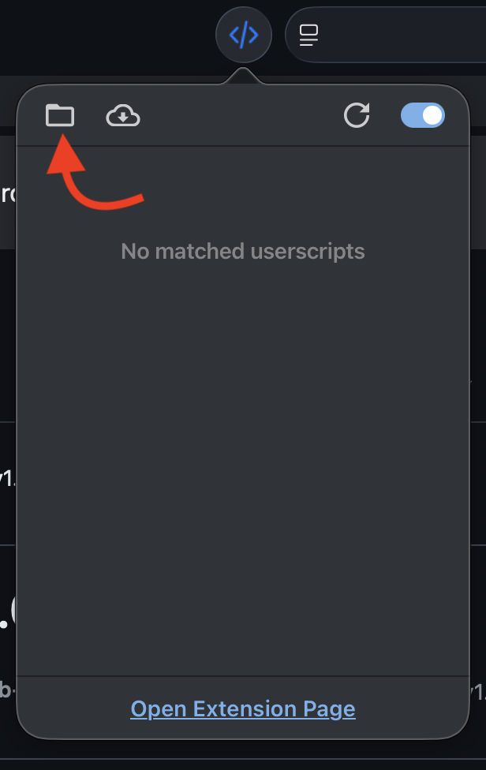
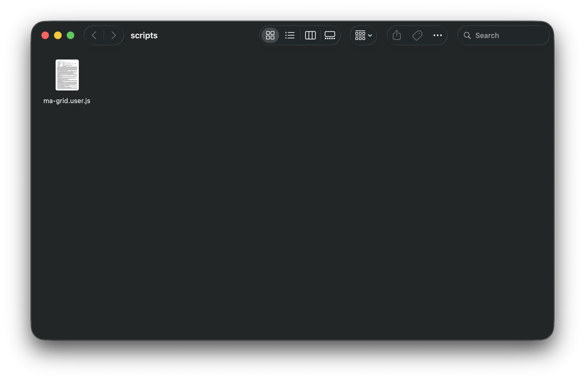
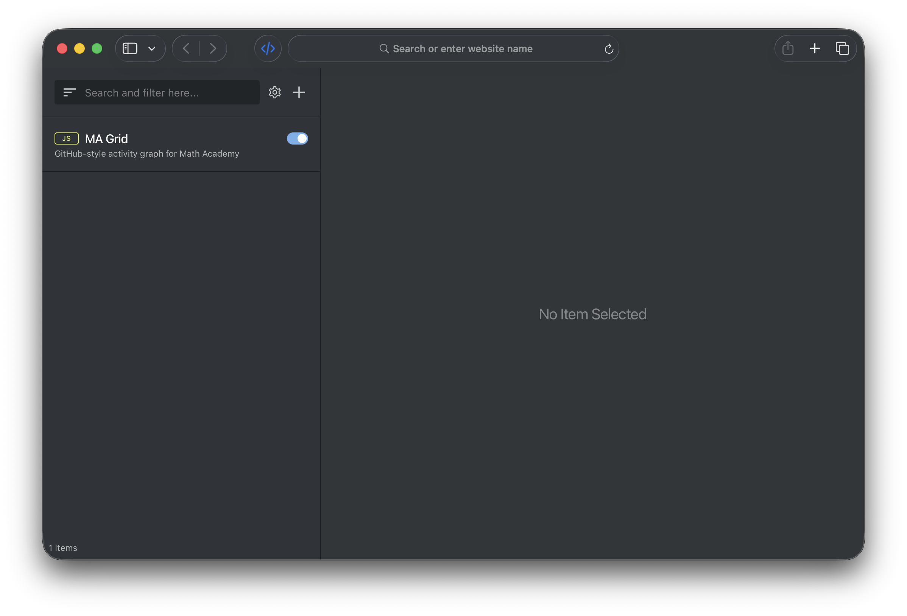

#  MA Grid

MA Grid is a web extension that displays a GitHub-style activity graph on Math Academy. It also includes some basic settings for placement (main feed or sidebar), an option to hide the existing XP tracker, and a button to clear cache.

This project is still in very early development. If you have any feature ideas or bugs, you're welcome to open an issue.

<a href="https://chromewebstore.google.com/detail/ma-grid/dbjdnjifbemgnefeidoeicnjhdlanflh"></a>
<a href="https://addons.mozilla.org/en-US/firefox/addon/ma-grid/"></a>

For Safari, please see the [Safari Installation](#safari-installation) section below.

# Screenshots

<table>
  <tr>
    <td></td>
    <td></td>
  </tr>
</table>

# Safari Installation

For Safari, you can install MA Grid as a userscript. This should work on iOS, iPadOS, and macOS.

1. Install [Userscripts](https://apps.apple.com/us/app/userscripts/id1463298887) from the App Store

2. Install the userscript:
   - Navigate to the [latest release](https://github.com/thaske/ma-grid/releases/latest) and click on **ma-grid.user.js** to download the userscript file
   - Click the Userscripts extension popup and select the Folder icon
     <br>
   - Drag or paste the downloaded **ma-grid.user.js** file into the folder
     <br>
   - Click "Open Extension Page" in the Userscripts popup, you should see **MA Grid** listed
     <br>

3. Done! You should see the activity graph on your dashboard.

# Copy math to Anki

On Math Academy task pages, click **Copy math** in the bottom-right corner, then click a formula. The source panel shows its original LaTeX—not the SVG markup.

- Pick **Entire formula** or an equation in the visual sidebar. A rendered preview updates as you edit the source.
- The LaTeX editor includes syntax highlighting, line numbers, matching braces, Tab/Shift+Tab indentation, and undo/redo. Highlighting never changes copied text.
- Highlight a fragment for **Copy selection**, or use **Copy equation**. Ctrl/⌘ + Enter copies the selection (or the current formula if nothing is selected).
- Edits are kept when switching equations within the current formula; **Reset edits** restores the selected equation's original source. Picking a different formula starts fresh.
- Choose the format for your paste destination:
  - **LaTeX · Anki math editor** (default): raw TeX, without delimiters, for Anki's MathJax editor.
  - **Anki HTML · field HTML editor**: `<anki-mathjax>…</anki-mathjax><br>` markup, for the field's HTML editor—not its normal rich-text view.
  - **Display math**: wraps TeX in `\[ … \]` for a regular card field.
- Standalone rows omit alignment markers and row breaks, preserving domain spacing with `\qquad`.
- Press Escape to cancel picking or close the panel. If clipboard access is denied, the output is selected for manual copying.

The extension reads retained MathJax source in the page world, with SVG-title and TeX-annotation fallbacks. Previews reuse the page's MathJax renderer without loading external scripts. If original source or preview rendering is unavailable (including userscript sandboxes that cannot access MathJax after a title is typeset), the panel reports that instead of treating flattened math as LaTeX.

# Development

If you want to contribute, here's how you can get started.

```sh
bun i     # install packages
bun wxt   # launch wxt, opens chrome with extension loaded
```

From there, you can login and navigate to the dashboard to view the graph.
